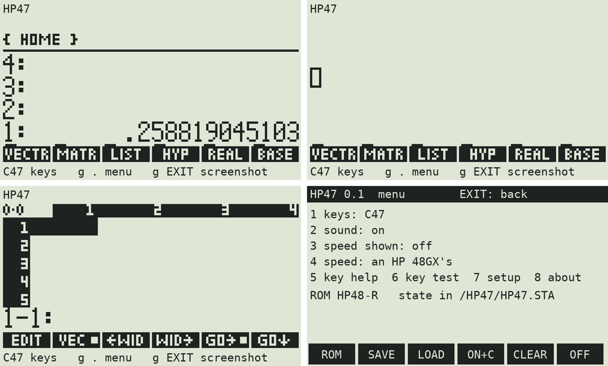
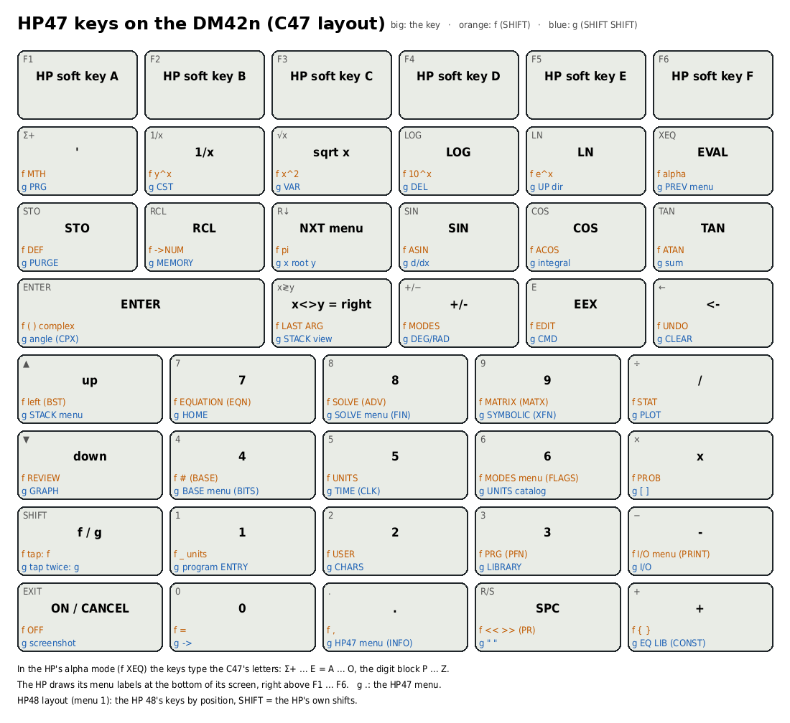

# HP47 — an HP 48GX for the SwissMicros DM42n

**HP47.pg5** is a stand-alone DMCP5 program written in C for the SwissMicros **DM42n**. It replaces the calculator
program (Free42 or C47) with an **HP 48GX** running HP's own ROM: RPL, the equation writer, the matrix writer,
SOLVE, PLOT, units, the equation library — the real thing, on the calculator's screen and keys.

Part of the "47" family of projects (almanac47, chess47.pg5, nav47.pg5, zx47.pg5, GB47 …).



> **Version 0.1: first build, not yet tested on the calculator.** Everything here runs on the PC with the real ROM
> (`make test`, `make keys`, `make shots`); the DM42n's speed, memory and QSPI are still to be seen.

## Install on the DM42n

1. **Back up the calculator disk first** (connect USB, copy everything).
2. Copy `release/HP47.pg5` to the root of the calculator's USB disk.
   Also keep the current `DM42-x.yy.pg5` (or your C47 `.pg5`) there, so you can go back.
3. Make a folder **`HP47`** on the disk and put an **HP 48G/GX ROM** in it as `HP48.ROM` (or keep the name
   `gxrom-r`). The ROM is HP's and is not part of HP47: see [roms/README.md](roms/README.md).
4. Open the DMCP menu: **SETUP → System → Run DMCP**, or press **RESET while holding F1**.
5. Choose **Load program → HP47.pg5**.

The first start asks **"Try To Recover Memory?"**: press **F6 (NO)**, as on a new HP 48.
To return to Free42 or C47: in HP47's menu press **7 setup → System**, or use **RESET+F1**. Needs DMCP5 3.57 or later.

**Where the ROM goes.** HP47 reads the 512 KB ROM into the heap when there is room. If the heap is too small it asks to
write the ROM once into DMCP's QSPI user area (and finds it there afterwards). *About* (menu 8) says where it is.

**The HP keeps its state.** When the calculator turns off (the HP's own OFF, its 10-minute auto-off, or the menu's
OFF), HP47 saves the HP's state and its 128 KB of RAM in `/HP47/HP47.STA`. The next start goes on where it was, and
the HP's clock moves on by the time it was off.

## Keys

Two layouts (menu **1**):

**C47** (the default): each key does what the **C47 overlay** says, as the HP 48's function of the same meaning.
SHIFT once = **f**, twice = **g** (the status line shows it), as on the C47. f 7 (EQN) is the HP's EQUATION writer,
f 8 (ADV) SOLVE, f 9 (MATX) the MATRIX writer, f ÷ STAT, g ÷ PLOT, f 5 UNITS, g 5 TIME … Where the C47 function has
no HP 48 counterpart, an HP key that has no other place takes it (MTH, PRG, CST, VAR, NXT, ' …).



**HP48**: the HP 48's keyboard by position: F1…F6 = A…F, the bottom block as the HP's, R/S = SPC, EXIT = ON.
SHIFT tapped is the HP's own left shift, tapped again its right shift. The keys that do not fit are on
**SHIFT held** + a key: x≷y = ◀ cursor, Σ+ MTH, 1/x PRG, √x CST, ← DEL, EXIT = the HP47 menu, . = screenshot.

F1…F6 are always the HP's soft keys: the HP draws their labels at the bottom of its screen, right above them.
The HP's ON combinations work: hold EXIT (ON) and press another key (ON+C restarts, as on a real 48).

## The HP47 menu (C47: g . · HP48: SHIFT held + EXIT)

| | |
|---|---|
| **F1 ROM** | choose the ROM file in `/HP47` |
| **F2 SAVE · F3 LOAD** | the HP's state to / from `/HP47/HP47.STA` (it is saved anyway when the calculator turns off) |
| **F4 ON+C · F5 CLEAR · F6 OFF** | restart (the RAM kept) · clear all of the HP's memory (asks first) · off |
| **1** keys · **2** sound | C47 / HP48 layout · the HP's beeper on the buzzer |
| **3** speed shown · **4** speed | the HP's speed against a real 48GX in the status line · an HP 48GX's / as fast as it goes |
| **5** key help · **6** key test | the C47 legends and what each does here · the keys as numbers |
| **7** setup · **8** about | DMCP's setup (USB disk, System, time, date, beep) · version, licences, ROM, memory |

## What works, what not yet

- The HP 48GX with its own ROM (G or GX ROMs, revision R tested), 128 KB of RAM, its clock and alarms, the beeper.
- Not yet: printing to an HP 82240B over the DM42n's IR (the HP's print commands; planned next), cards in ports 1
  and 2, file transfer (planned: objects to and from `/HP47` on the USB disk), the 48S/SX ROMs.
- HP-to-HP infrared transfer cannot work: the DM42n's IR only sends.

## Build

Requirements: `arm-none-eabi-gcc` with newlib, `make`, `python3` (Pillow for the pictures). The tests need a ROM in
`roms/gxrom-r`.

```bash
cd ~/opt/hp47.pg5
make              # -> build/HP47.pg5 (copy it to release/ for a release)
make test         # boot, arithmetic, the state round trip, the BEEP's pitch (on the real ROM)
make keys         # every C47-layout key run on the ROM -> build/keys/keys-*.png
make shots        # the PC simulator's screens -> build/sim/run/*.png
python3 tools/keymap.py docs/keymap.png    # the keys picture
```

## Inside

| | |
|---|---|
| `src/main.c` | the loop, the key sequencer, the status line, the menu, the ROM and the state files, power |
| `src/hp48.c` | the HP 48GX around the CPU: memory controllers, I/O registers, timers, keyboard, LCD |
| `src/screen.c` | the HP's 131 × 64 LCD three times as big, only the changed lines |
| `src/keys.c` | the two layouts: the C47 legends and the HP 48's keyboard |
| `third_party/x48/` | the Saturn CPU of [x48](https://github.com/deadcodesoc/x48) by Eddie C. Dost (GPL-2.0-or-later) |
| `test/` | `hptest.c` (the HP on the PC), `run.sh`, `keys_check.py`, `shots.sh`, the simulator |

## Licence

GPL-3.0-or-later (see `LICENSE` and `NOTICE`). Written with the help of AI, as a cooperation: see
[AI_ASSISTANCE.md](AI_ASSISTANCE.md).
